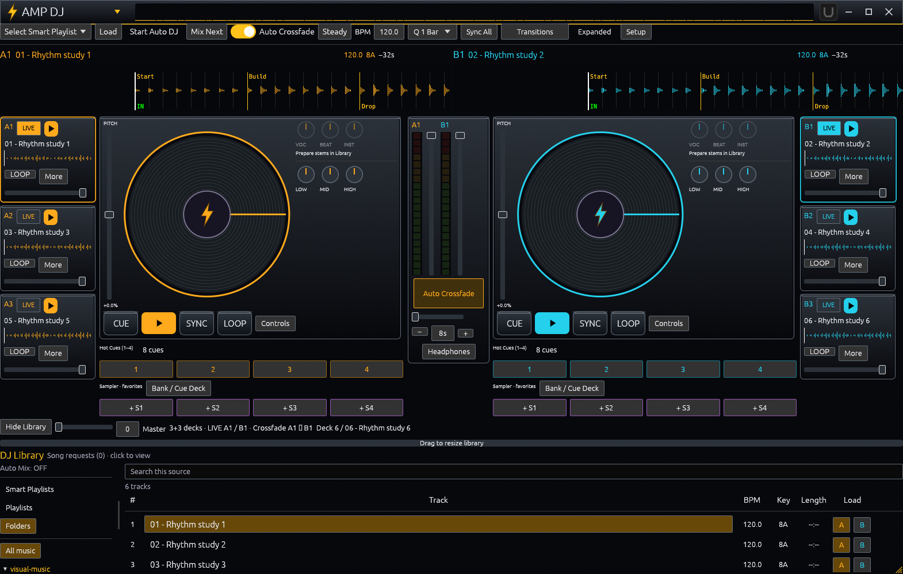
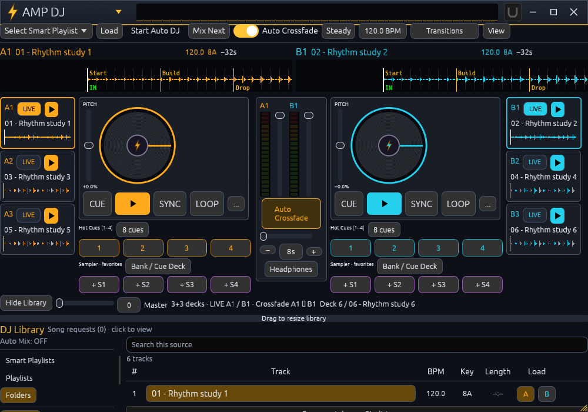
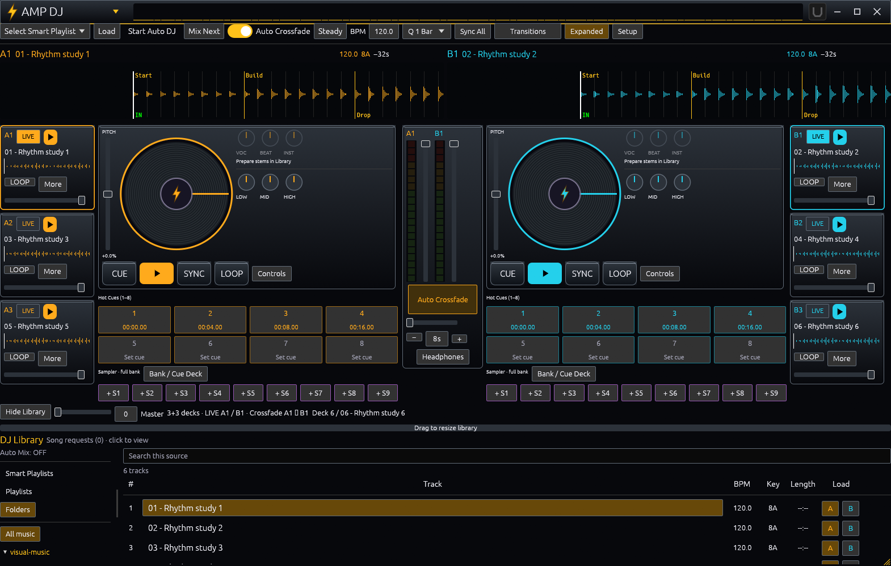
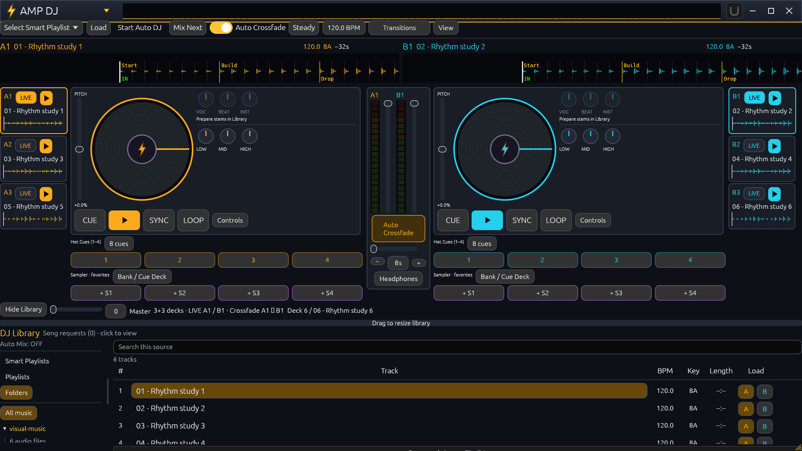

# DJ responsive, UX and retro Winamp pass

Applied to the six-deck preview on `feature/six-deck-controls`. This pass changes presentation and access to controls, not decoder/routing behavior. Existing original two-deck layout remains supported.

## Audit and corrections

| Finding | Correction |
| --- | --- |
| A 1000x700 window scaled the whole 1400x1000 design, making controls tiny. | Reflow at normal text/control sizes. Short deck strips and a compact BPM/View menu fit smaller windows. Controlled scaling is retained below the minimum usable layout. |
| Stacked meters and channel faders consumed the browser's height. | Faders sit beside meters. The music browser retains visible space, with its draggable divider preserved. |
| Duplicated Auto Mix controls competed with each other. | The top toolbar is the primary Auto DJ control. The library shows status rather than a second switch. |
| Headphones opened another full mixer. | Its menu now contains output selection, cue/master blend, headphone volume and related output tools. Deck-specific controls stay with their deck. |
| Compact strips carried too many permanently visible buttons. | Keep LIVE, transport, title and waveform. Select LIVE and use the main deck's Controls menu for volume, filter, EQ, stems, private cue, fade and Key Lock. Wider strips also expose loop/volume/More. |
| Expanded cues/pads could push the browser out of a short window. | Short windows expose eight cues in a popup and retain four favorite pads, with the full bank available through Bank / Cue Deck. Roomy expanded windows keep eight cues/nine pads inline. |
| Empty sampler pads were indistinguishable plus symbols; long names could wrap. | Pads identify their slots (+ S1, + S2...), fill the available row evenly, and truncate long labels. Existing assignments/context actions remain. |
| Repeated cue headings and ambiguous expansion labels added clutter. | One cue heading; a clear 8 cues control; no redundant expand toggle when already expanded. |
| The Classic theme looked flat. | Original vector metal gradients, inset borders and button highlights strengthen the Winamp appearance. Amber A, cyan B and purple sampler outlines remain consistent; Modern Dark retains flatter surfaces. |

## Verification

- Player tests: 132 passed, 33 explicit hardware/codec/benchmark exclusions. Strict workspace Clippy passes.
- A rendered-layout regression uses the actual Modern Dark theme and checks the global play-button size plus reserved browser space at 1000x700, 1280x800 and 1570x1000. Includes short Expanded mode and Manual Lock. It caught the hidden-browser regression during this pass.
- Real application captures reviewed at 1570x1000 compact/expanded, 1000x700 compact/expanded, 1920x1080 at 125%, and a large 2560x1440 window. Generated rhythmic WAV fixtures are paused and muted; waveforms/cues are genuine fixture data.
- The previous six-deck playback, pair isolation and continuity tests remain applicable; this pass does not replace the audio engine.

## Screenshots

## Operating notes

In a narrow window, **BPM** contains master tempo, quantization and Sync All; **View** contains expanded controls and layout/setup options. **Transitions** stays directly accessible. **Steady / Hype / Chill** opens mixing style and Manual DJ Lock. Each selected deck has a **Controls** menu (shown as **...** when narrow). **Bank / Cue Deck** retains full sampler and auxiliary playback access.

Below approximately 980x700 logical pixels, fitting all six decks requires scaling. Expanding detailed preparation belongs in AMP Library; the main DJ controls remain prioritized. The existing Windows network-permission prompt and actual Companion-host acceptance are separate from this UI pass.
## Smart Playlist genre filter

Library > Smart Playlists now includes Genres below Music sources. Keep All genres for existing behavior, or choose multiple genres (for example Rock and R&B). Any selected genre may match; the filter also applies to the combined folder/playlist sources, exclusions, Preview Mix, Auto DJ and Smart Radio. Requests cannot bypass the genre filter. Saving and portable playlist export retain the selection.

Genre tags are read from audio during background library scanning without analysis, decoding, changing source audio, or creating sidecars. Portable manually saved genre tags take priority. Matching ignores case and supports R&B/RnB/Rhythm & Blues aliases and semicolon/slash-separated tags; it matches named tags rather than guessing genre or expanding Rock into every subgenre. Untagged songs remain available with All genres and are skipped when filtering. Edit them through Library tags in track preparation. Existing startup snapshots remain usable while the background scan fills in embedded tags.

Genre validation: 46 core tests and 132 player tests passed; strict workspace Clippy passed. A real application capture with four tagged/untagged WAV fixtures shows exactly two matches for Rock + R&B. Tests cover source/exclusion constraints, recent-repeat fallback, request rejection, manual tag precedence, backward-compatible settings, UI Save Playlist and portable export/import.
