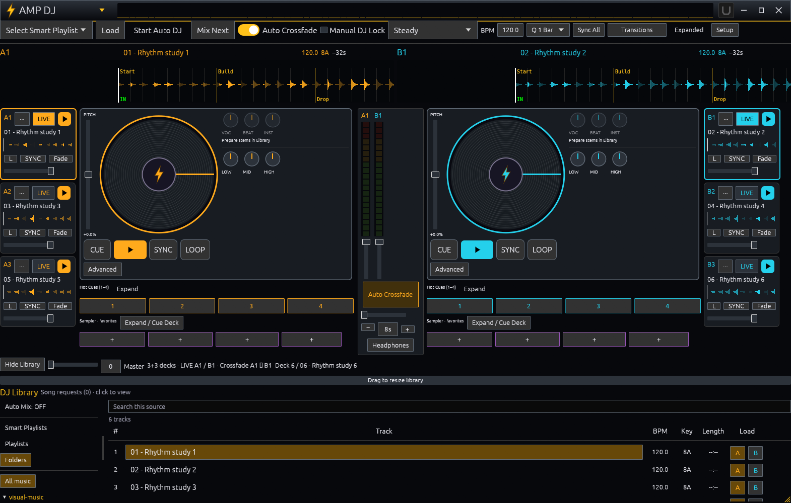
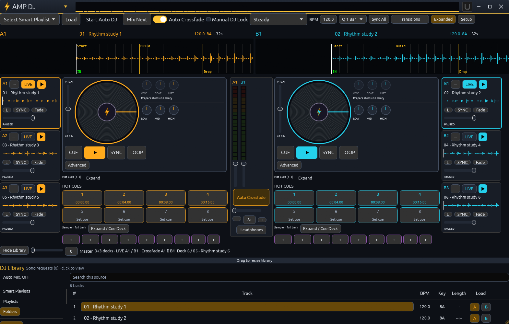

# Six-deck implementation and acceptance record

Branch: `feature/six-deck-controls`. This is a development preview, not a production release announcement. Production binaries are preserved. The local preview is installed beside them at `%LOCALAPPDATA%/Programs/AMP Verse Six Deck Preview`, with desktop shortcut **AMP DJ Six Deck Preview**, separate settings and the standard Remote/Cast ports 8790/8787. Its Library and Cast loaded all 4,405 NAS songs; both were left idle with analysis off. The separate MP3 Lab repository is unchanged.

## Implemented

- Six simultaneous independent voices: A1/A2/A3 and B1/B2/B3 in one native output stream. Each has its own decoder/timeline, transport, gain, EQ/filter, loop, sync, stems, cue state and fade. Two LIVE jogs select focus without changing routing.
- Auto DJ, section changes, crossfades, scratch/stutter/brake/filter/bass/stem effects and phrase mashups operate on the assigned pair. Four background layers remain independent. Pair reassignment requires old/new pairs paused and automation stopped.
- Sample-clock master BPM, continuous phase during tempo changes, quantized launch and loop capture, synchronized rates, per-deck Signalsmith Stretch Key Lock. Prepared stems share one aligned timeline. Vinyl scratch bypasses pitch preservation.
- Compact UI: two scrolling waveforms, two vector vinyl jogs, two three-strip groups, four cues and four sampler favorites per side. Expanded: eight cues and all nine pads. Favorite mappings survive layout changes. Cue Decks retain separate auxiliary playback.
- Master BPM/Q/Sync All, visible Transitions menu, saved crossfade duration stepper, resizable DJ Library, amber A/cyan B, purple sampler controls. The original two-deck layout remains available in Setup.
- Shared waveform peak buffers, including coalesced concurrent decodes. No analysis/separation on the audio callback. Header meters use actual envelopes, not a simulated spectrum.
- Paused six-deck session recovery: tracks, positions, focus, pair, gain, pitch, EQ/filter, stems, sync, Key Lock and clock. Legacy two-deck snapshots load. Stable initial window sizes preserve the resize/maximize fix.
- Companion opt-in on regular and Smart Playlists, scoped/paged playlist song/cue discovery, request/session identity fences, duplicate suppression, reconnect without replaying transport. Analyzed tracks use preparation fingerprints as resource IDs; legacy IDs remain accepted.
- Official Companion SDK module with deck controls plus Player, Auto DJ/safety, energy/FX, sampler and Cast preset pages. Includes scenes, Recognition context, stem presets, loops, clock, pair-only pause/resume and separate Cast credentials. Live variables cover six decks, both pad banks, clock, energy/progression, receiver, broadcast and polled station state.
- Device-local music scenes store playlist/style/energy/fade/clock in one database. Recall does not change the pair or stop background layers.
- Independent Cast station playlist launch and revision-checked runtime energy/style/progression, applied at next selection. Processed live broadcast selects DJ master or Player/A1, independent level/mute/stop, excluding private headphone cue. Google receiver discovery, confirmed status/volume and targeted stop.
- Android stays two-deck, with local/offline playback preserved and no analysis engine. Added desktop sync, Key Lock, loops, prepared-stem tools and Google speaker controls. Pixel development APK: 0.2.0-dev, code 20.

## Verification

- Player default tests: 132 passed; 33 hardware/codec/benchmark tests explicitly excluded from the default run. Workspace tests and strict Clippy passed. Relevant codec/native tests also run explicitly.
- Pitch test: 116% varispeed corrected from about 510 Hz back to 440 Hz. Dry/wet impulse peaks match at 2176 frames. Section handoffs retain processor history; EOF drains the delayed tail.
- Synthetic DSP matrix: two/six dry decks, six synchronized Key Lock streams, prepared stems, loops, effects and pair Auto DJ with four layers. Two seconds rendered in 232-786 ms in the debug build, finite signal and zero test underruns. Six Key Lock streams rendered five seconds in about 1.87 seconds.
- Real release process: six generated WAV decoders play; LIVE preserves routing; unsafe pair changes reject; independent fade and Auto DJ handoff/pause/resume preserve background decks; scoped pages and emergency stops pass.
- Short native profile with HTTP at 5 Hz and actual Companion WebSocket client: two active/six prepared 9.3% of one CPU core, 249.5 MiB peak; six active 15.7% of one core, 268.4 MiB peak including decoders. All six underrun counters zero. Companion received 372 actual state updates.
- Sustained short-cue regression: three automatic end-of-cue handoffs, Auto DJ remained on, three independent background loops continued, all six underrun counters zero. Run with `AMP_CONTINUITY=1` separately from profiling.
- Pixel 7: installed app/test APKs; command, auxiliary cue and retry protocol test passes over USB forwarding. Direct Wi-Fi attempt timed out; Windows has blocking rules for the development executable. Direct Wi-Fi is not counted as passing.
- Physical Bigo speaker: isolated quiet generated audio, receiver-confirmed PLAYING, reported existing volume/mute acknowledged, targeted stop confirmed. No claim of human acoustic-quality acceptance.
- Companion: five client/action/preset/feedback contract tests pass; official SDK package generation passes. A real Companion host is not installed here, so host button/feedback acceptance remains outstanding.
- Windows, Linux, Android and Companion GitHub checks passed at checkpoint `effc6da`. Final-head checks are tracked on the PR. Linux checks include real codec tests, native X11 docking, screenshots and packaging.
- Actual screenshots at 1570x1000, 1000x700 and 1920x1080, compact/expanded, Classic/Modern Dark and 125% scaling. Native maximize held at 2560x1552; restore/native resize held at 1429x1000 without rubberbanding. Local screenshots/logs: `test-output/six-deck` (excluded from Git).

## Use

Select LIVE on a mini strip to move the jog focus. Use Setup / Assign crossfader to LIVE pair after pausing both pairs and stopping Auto DJ. Background layers keep playing. Expanded shows eight cues/all pads; compact shows four cues/favorites. Transitions is directly on the toolbar; duration is the center stepper. Drag the divider above DJ Library. Setup also restores the original two-deck layout.

In Library, enable Available in Companion on desired playlists and save. In Companion, refresh playlists, select a playlist/search/page, Learn songs, then Learn the chosen song's cues. Normal discovery returns 50-song pages, not the full library. Refer to `integrations/companion/README.md` for host setup.

## Limits

- Pitch processing adds 2176 frames (45.3 ms at 48 kHz) before hardware buffering; dry, locked and scratch paths share it. Acoustic scratch/Key Lock acceptance and long-duration performance testing remain required. `AMP_DISABLE_KEYLOCK=1` disables this backend for slower systems. Missing Windows DLL disables Key Lock truthfully.
- `amp-keylock.dll` and bundled Signalsmith MIT notices must ship beside the Windows player. Packaging and installation include them.
- Fingerprint identity stays rename-independent while preparation remains associated with its audio. Unanalyzed files retain path IDs. Recovering preparation after arbitrary external moves is still an edge case.
- Player transport retains the existing A1 voice. Distinct Stop Player stops A1 only, leaving the other five decks, pads and radio alone; it is not a seventh independent voice.
- Short synthetic/native benchmarks do not certify older hardware or a long live show. Real Companion-host acceptance and direct Android Wi-Fi acceptance remain outstanding as above.

## Reproduce and delivery

`python tools/smoke_six_deck.py <player.exe> <adb.exe>` uses isolated temporary fixtures/settings. Optional `AMP_PROFILE=1` enables psutil/Node measurement. `AMP_ANDROID_HOST=<PC LAN IP>` selects direct Wi-Fi rather than USB forwarding. `python tools/smoke_google_output.py <player.exe> <cast.exe> "Bigo speaker"` requires that explicitly named receiver and never chooses a substitute.

PR: https://github.com/gitwide-cloud/amp-verse/pull/1

Initial implementation: `922afc779f710d58eceaaacf86a3afc73adc9059`. Pitch timing and CI migration checkpoint: `effc6da8c0e3b48e1a28e8c1585ac44fb9359069`. Final commits and Actions artifacts are linked on the PR. Artifacts include Windows/Linux desktop packages, analysis add-ons, Android preview APK, Companion SDK package and UI screenshots. No production release tag is created by this branch.
## Real application captures

Generated rhythmic WAV fixtures, paused transports, muted master, no simulated waveform or activity. Disabled stems truthfully indicate unprepared fixtures.

The responsive/simplification follow-up is documented in [DJ UX audit](DJ_UX_AUDIT.md), including updated real screenshots and the short-window browser/readability regression.
